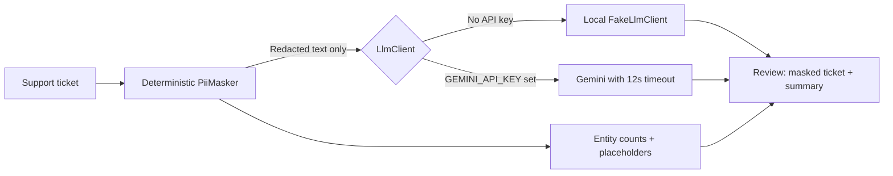

# PII Redact Desk

PII Redact Desk is a small Harbor Desk support-ticket workspace that removes email addresses, phone numbers, and Harbor Desk order IDs **before** asking an AI model to summarize a ticket. The first pass is deterministic PHP, so redaction works even when no model key is configured.

## How the AI boundary works



`PiiMasker` replaces matching values with numbered tokens such as `[EMAIL_1]`, `[PHONE_1]`, and `[ORDER_ID_1]`. The stored entity metadata contains only category, count, and placeholder labels—never matched values. The `LlmClient` contract accepts only the redacted text. Provider errors and timeouts leave the successful deterministic redaction available with a missing summary instead of producing an unhandled AI error.

The demo persists the original ticket and redacted result so the side-by-side review has a real job record. Use synthetic data only; do not paste real customer PII or PHI into this demo.

## Run locally without an API key

Requirements: PHP 8.3+, Composer, Node.js 22+, and pnpm.

```bash
composer install
cp .env.example .env
php artisan key:generate
php artisan migrate --seed
pnpm install
```

Run the app and Vite in separate terminals:

```bash
php artisan serve
pnpm dev
```

Open the Laravel URL shown by `php artisan serve` (usually `http://127.0.0.1:8000`). The four seeded tickets use reserved example.com addresses, reserved-format sample phone numbers, and fictional Harbor Desk order IDs. With `GEMINI_API_KEY` blank, the app binds `FakeLlmClient`; the complete redaction and review flow works without network calls or credentials.

To use Gemini, set `GEMINI_API_KEY` in `.env` and restart Laravel. `GEMINI_MODEL` optionally selects a model (defaults to `gemini-2.5-flash`). Requests have a 12-second timeout. Only the redacted ticket is sent to Gemini.

## Verify

```bash
composer test
pnpm check
pnpm types:check
pnpm build
```

The Pest suite checks the deterministic email/order/phone replacements and safe metadata, the guest POST response, that the fake LLM receives masked text only, fake binding without an API key, graceful summary failure, and the configured Gemini request boundary. No real provider request is made in tests.

## Stack

- Laravel 13 / PHP 8.3
- Vue 3 + Inertia + Tailwind CSS
- SQLite by default
- Gemini optional; no Redis or queue worker required
